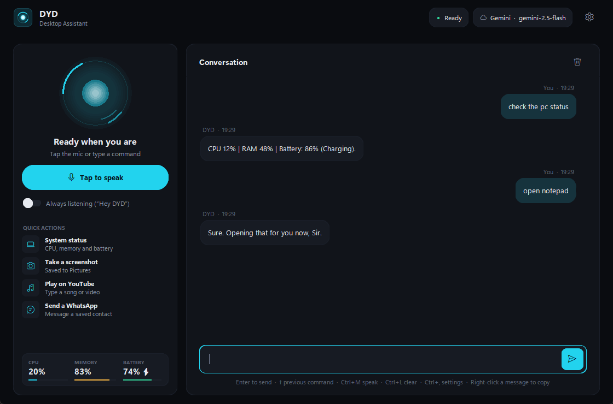
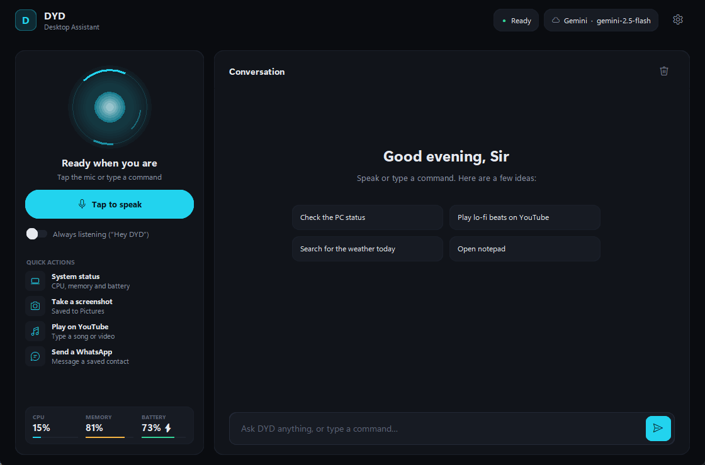
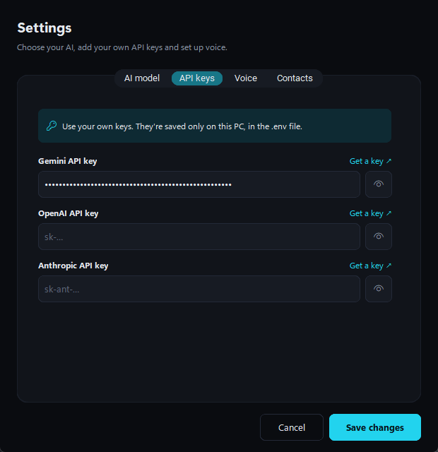

# DYD – AI Desktop Assistant for Windows

DYD is a voice and text desktop assistant for Windows, inspired by J.A.R.V.I.S. Common PC commands
(opening apps, volume, YouTube, WhatsApp, screenshots) run locally without an AI call, and everything
else goes to the AI provider you choose: **Google Gemini, OpenAI, Anthropic Claude, or a local Ollama model**.

> Platform: **Windows 10/11 only** (uses Windows APIs for volume, app launching and WhatsApp Desktop).



<p align="center">
  
  
</p>

## Features

- **Modern interface** — chat bubbles, an animated status orb, live CPU/memory/battery stats, a welcome
  screen with suggested commands, toast notifications and keyboard shortcuts.
- **Choose your AI** in *Settings*: Gemini, OpenAI, Claude, or Ollama (free, offline), each with its own model.
- **Local commands, no AI round trip** — handled instantly by pattern matching:
  - Apps: "Open Chrome", "Open Notepad", "Close Spotify"
  - Web: "Search for Python tutorials", "Open github.com in Chrome"
  - YouTube: "Play Night Changes on YouTube"
  - WhatsApp Desktop: "Send message to Dad on WhatsApp saying I'm on my way"
  - System: "Check PC status" (CPU, RAM, battery), "Volume up", "Mute", "Take a screenshot"
- **Voice input** with automatic microphone selection and an optional background wake word ("Hey DYD").
- **Text-to-speech replies** using the built-in Windows voices.
- **Microphone test** in Settings to check recognition before you use it.

## Requirements

- Windows 10 or 11
- Python 3.10+
- A microphone (for voice mode)
- At least one AI provider:
  - Gemini API key — free at [Google AI Studio](https://aistudio.google.com/apikey), or
  - OpenAI / Anthropic API key, or
  - [Ollama](https://ollama.com) installed locally with a model pulled (e.g. `ollama pull llama3.2`)
- For WhatsApp commands: WhatsApp Desktop installed and logged in

## Setup

```bash
git clone https://github.com/desanyasandu/Automater.git
cd Automater
pip install -r requirements.txt
copy .env.example .env
```

### 🔑 Bring your own API key

**No API key is included in this repository.** To use a cloud AI provider you must create your own key:

| Provider | Get a key |
|---|---|
| Google Gemini (free tier) | <https://aistudio.google.com/apikey> |
| OpenAI | <https://platform.openai.com/api-keys> |
| Anthropic Claude | <https://console.anthropic.com/settings/keys> |
| Ollama (no key needed) | <https://ollama.com/download> |

Paste it into `.env` (e.g. `GEMINI_API_KEY=your_key`) or into **Settings → API keys** in the app (gear icon, or `Ctrl+,`).
Keys are saved only to your local `.env`, which is git-ignored — never commit it or share it.
If the app says your key was rejected, create a new one and enter it in Settings.

To use WhatsApp commands, add contacts as `NAME=countrycode+number`, e.g. `DAD=94771234567`.

> If `pip install PyAudio` fails, update pip (`python -m pip install --upgrade pip`) and try again.

## Run

Double-click `run.bat`, or:

```bash
python main.py
```

## Keyboard shortcuts

| Shortcut | Action |
|---|---|
| `Enter` | Send the command |
| `↑` / `↓` | Cycle through previous commands |
| `Ctrl+M` | Start voice input |
| `Ctrl+K` | Focus the command box |
| `Ctrl+L` | Clear the conversation |
| `Ctrl+,` | Open settings (`Esc` closes, `Ctrl+S` saves) |
| Right-click a message | Copy it |

## Configuration

All settings live in `.env` and can be changed from the Settings window:

| Setting | Default | Description |
|---|---|---|
| `AI_PROVIDER` | `GEMINI` | `GEMINI`, `OPENAI`, `CLAUDE` or `OLLAMA` |
| `GEMINI_MODEL` | `gemini-2.5-flash` | Any Gemini model id |
| `OPENAI_MODEL` | `gpt-4o-mini` | Any OpenAI chat model id |
| `CLAUDE_MODEL` | `claude-haiku-5-5` | Any Claude model id |
| `OLLAMA_MODEL` | `qwen2.5:32b` | Any model you've pulled in Ollama |
| `ASSISTANT_NAME` / `USER_NAME` | `DYD` / `Sir` | How the assistant names itself and you |

## Project structure

| File | Purpose |
|---|---|
| `main.py` | Entry point |
| `gui.py` | Main window: wires the UI components to the assistant |
| `ui/theme.py` | Design tokens — colors, fonts, spacing |
| `ui/header.py`, `ui/sidebar.py`, `ui/chat.py` | Header bar, left panel and conversation view |
| `ui/orb.py`, `ui/stats.py` | Animated status orb and live system stats |
| `ui/settings.py`, `ui/toast.py`, `ui/widgets.py` | Settings dialog, notifications and shared widgets |
| `assets/` | App icon |
| `gemini_brain.py` | Local command dispatcher and AI provider calls |
| `actions.py` | Desktop automation (apps, volume, WhatsApp, YouTube, screenshots) |
| `speech_engine.py` | Speech recognition and text-to-speech |
| `config.py` | Reads and writes settings in `.env` |

## Privacy

Your API keys and contacts are stored only in your local `.env` file, which is git-ignored.
Text sent to a cloud provider is subject to that provider's terms; use Ollama to keep everything offline.

## License

[MIT](LICENSE) © Desan Yasandu
